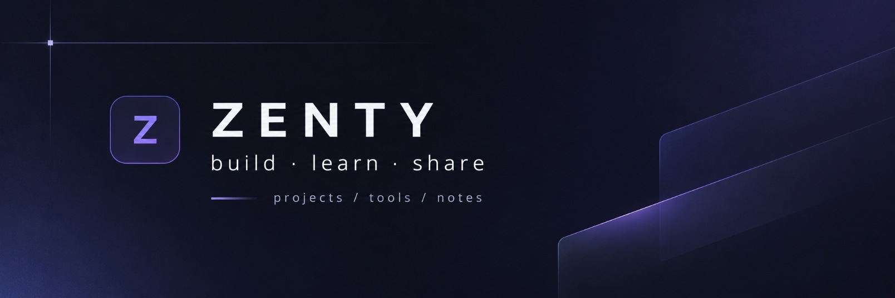

  <picture>
    <source media="(max-width: 640px)" srcset="assets/banner-mobile.webp" type="image/webp">
    <source srcset="assets/banner.webp" type="image/webp">
    
  </picture>

### 在做的项目

- **[pi-switch](https://github.com/Zenty-Me/pi-switch)** — 给 Pi 加一层按项目的 Skills / MCP 开关，聊需求给建议，确认就应用，配置能存成模板。
- **[agent-toolbox](https://github.com/Zenty-Me/agent-toolbox)** — 按 Pi / Claude Code / Codex 分区的工具箱，放插件、skills 和提示词。
- **[aiguide](https://aiguide.zenty.top/)** — 中文 AI 编程与 Agent 指南，把学到的整理成能照着走的路线。
- **[modelmeter](https://github.com/Zenty-Me/modelmeter)** — 估算并对比 OpenAI / Anthropic / Gemini 的 API 花费。
- **[PromptPilot](https://github.com/Zenty-Me/PromptPilot)** — 把提示词一键注入网页版 AI 的 Chrome 扩展。
- **[轻衣橱](https://github.com/Zenty-Me/qing-yichu)** — 本地优先的电子衣橱 PWA，数据只留在手机上。

### 找到我

[博客](https://blog.zenty.top/) · [AI Guide](https://aiguide.zenty.top/) · [全部仓库](https://github.com/Zenty-Me?tab=repositories)
