<picture>
  <source media="(prefers-color-scheme: dark)" srcset="https://raw.githubusercontent.com/Zenty-Me/Zenty-Me/main/assets/banner-dark.svg">
  <source media="(prefers-color-scheme: light)" srcset="https://raw.githubusercontent.com/Zenty-Me/Zenty-Me/main/assets/banner-light.svg">
  
</picture>

Java 后端出身，写 Spring 与 JVM，做过 Python 爬虫；现在把大部分时间花在 AI Agent 上——让 Codex、Claude Code、Pi 这类工具真正能干活，而不只是演示。

喜欢小而锋利、装上就能用的东西：一个面板、一个扩展、一份能照着跑的指南。

### 正在做

- **[Pi Switch](https://github.com/Zenty-Me/pi-switch)** —— Pi 里的项目级 Skills / MCP 开关面板：聊完就地给出建议，确认即应用，配置存成可复用模板。
- **[Zenty AI Guide](https://aiguide.zenty.top/)** —— 面向中文开发者的 AI 编程与 Agent 开发指南，Codex、Claude Code、MCP、Skills 各一条学习路线。
- **[Agent Toolbox](https://github.com/Zenty-Me/agent-toolbox)** —— 按 Pi / Claude Code / Codex 分区的个人能力库，同一份 skills 与提示词，三个宿主各自记录版本。

### 精选项目

| 项目 | 做什么 | 栈 |
| :-- | :-- | :-- |
| [pi-switch](https://github.com/Zenty-Me/pi-switch) | 项目级 Skills & MCP 开关，带 AI 建议与模板复用 | TypeScript |
| [aiguide](https://github.com/Zenty-Me/aiguide) | 中文 AI 开发指南，纯静态、站内搜索、零追踪 | Astro · TS |
| [agent-toolbox](https://github.com/Zenty-Me/agent-toolbox) | 跨 agent 的能力同步库：插件 / skills / 提示词 | Python |
| [modelmeter](https://github.com/Zenty-Me/modelmeter) | 估算并对比 OpenAI / Anthropic / Gemini 的 API 成本 | TypeScript |
| [PromptPilot](https://github.com/Zenty-Me/PromptPilot) | 把提示词一键注入网页版 AI 的 Chrome 扩展 | JavaScript |
| [轻衣橱](https://github.com/Zenty-Me/qing-yichu) | 本地优先的电子衣橱 PWA，数据只留在手机上 | TypeScript |

### 常用工具

```text
后端    Java · Spring Boot · JVM · MySQL · Redis · Elasticsearch · XXL-JOB
语言    Java · Python · TypeScript · SQL
Agent   Pi · Claude Code · Codex · MCP · Agent Skills
前端    Astro · Vue · Tailwind CSS
```

### 写作

- **博客** —— [blog.zenty.top](https://blog.zenty.top/)：Java、分布式、数据库、爬虫与 AI 工程的学习笔记。
- **AI Guide** —— [aiguide.zenty.top](https://aiguide.zenty.top/)：一次真实任务 → 一个可验证结果的教程集。

<p align="right"><sub>心之所向，素履以往 · <a href="https://github.com/Zenty-Me?tab=repositories">repositories</a> · <a href="https://blog.zenty.top/">blog</a></sub></p>
